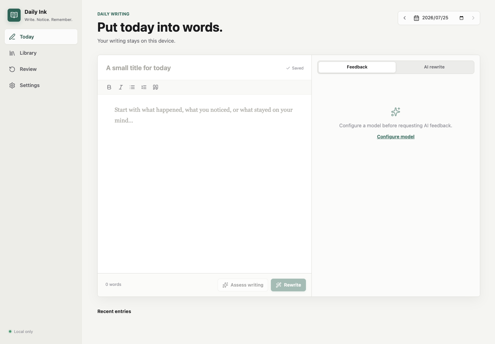
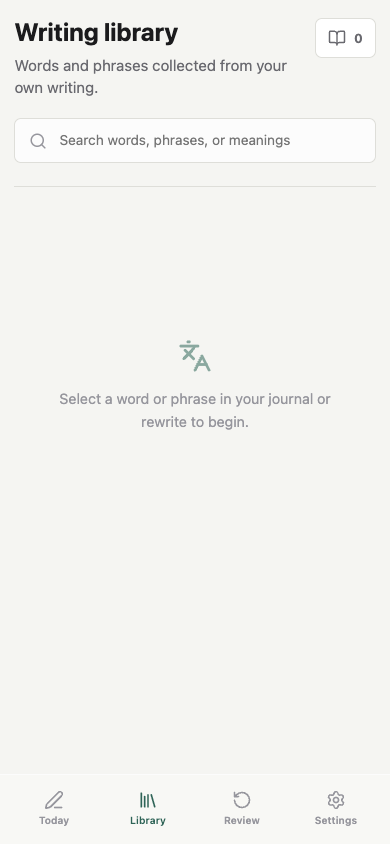

<p align="center"></p>

<div align="center">

# Daily Ink

**A private English writing journal that turns daily practice into actionable feedback and durable vocabulary.**

[English](README.md) · [简体中文](README.zh-CN.md)


[](https://github.com/yruichen/daily-ink/actions/workflows/ci.yml)
[](LICENSE)
[](https://github.com/yruichen/daily-ink/stargazers)

</div>

Daily Ink is a local-first writing workspace for IELTS learners and anyone
improving their English through regular journaling. Write in your own words,
request an IELTS-style proficiency estimate, compare an AI rewrite, collect
useful expressions from either version, and review them with FSRS spaced
repetition.

> [!IMPORTANT]
> Daily Ink is in early development. The free-writing score is an
> **IELTS-style estimate**, not an official IELTS result. Database schemas and
> APIs may change before the first stable release.

## Screenshots

<table>
  <tr>
    <td width="70%">
      
    </td>
    <td width="30%">
      
    </td>
  </tr>
  <tr>
    <td align="center"><strong>Focused desktop writing workspace</strong></td>
    <td align="center"><strong>Responsive mobile library</strong></td>
  </tr>
</table>

## Features

- **Daily writing workspace** with rich-text editing, automatic saving, and
  date-based journal history.
- **IELTS-style feedback** across Content & Development, Coherence & Cohesion,
  Lexical Resource, and Grammatical Range & Accuracy.
- **Meaning-preserving AI rewrites** for natural English or a selected target
  band.
- **Bring your own model** through OpenAI-compatible or Anthropic-compatible
  APIs, including local endpoints such as Ollama and LM Studio.
- **Contextual vocabulary capture** from both the original entry and the AI
  rewrite, with support for words and phrases.
- **FSRS spaced repetition** with separate recognition and contextual
  production cards.
- **Local-first privacy**: journal data and encrypted provider credentials stay
  on the machine running the server.
- **English and Simplified Chinese UI**, selected from the browser language on
  first launch and switchable at any time.
- **Versioned prompts outside application code**, with prompt IDs, semantic
  versions, schemas, and content hashes recorded with AI results.

## Tech Stack

| Area     | Technology                                                         |
| -------- | ------------------------------------------------------------------ |
| Web      | React 19, Vite, TanStack Query, Tiptap, i18next                    |
| API      | Node.js, Fastify, Zod                                              |
| Data     | SQLite, Drizzle schema definitions, repository adapters            |
| AI       | OpenAI Chat Completions and Anthropic Messages compatible adapters |
| Memory   | `ts-fsrs`                                                          |
| Quality  | TypeScript strict mode, ESLint, Vitest                             |
| Delivery | npm workspaces, Docker, production API bundle                      |

## Quick Start

### Requirements

- Node.js 22.22 or newer
- npm 11 or newer
- An AI endpoint only if you want assessment, rewriting, or vocabulary
  enrichment. Journaling and review work without one.

### Development

```bash
npm install
npm run dev
```

Open <http://127.0.0.1:4318>. The development API listens on
`http://127.0.0.1:4317`.

### Production-style local build

```bash
npm run build
npm start
```

Open <http://127.0.0.1:4317>. The API serves the built web application from the
same origin.

### Docker

```bash
docker compose up --build
```

Open <http://127.0.0.1:4317>.

When the application runs inside Docker, `127.0.0.1` refers to the container.
Use an address reachable from the container for a model running on the host,
such as `host.docker.internal` on Docker Desktop.

## Model Configuration

Open **Settings → New connection**, choose a preset, and test the saved
connection.

| Provider  | Default base URL            | Protocol                       |
| --------- | --------------------------- | ------------------------------ |
| OpenAI    | `https://api.openai.com/v1` | OpenAI compatible              |
| Anthropic | `https://api.anthropic.com` | Anthropic compatible           |
| Ollama    | `http://127.0.0.1:11434/v1` | OpenAI compatible              |
| LM Studio | `http://127.0.0.1:1234/v1`  | OpenAI compatible              |
| Custom    | User supplied               | OpenAI or Anthropic compatible |

Disable **structured output** for endpoints that do not implement native schema
constraints. Daily Ink then includes the versioned JSON schema in the external
prompt and validates the returned object before saving it.

Provider keys are encrypted with AES-256-GCM before they are written to SQLite.
The local encryption key is stored separately in `data/app.key`.

## Prompt Versioning

Prompts are files, not string constants embedded in TypeScript:

```text
prompts/<capability>/<semver>/
├── manifest.yaml
├── system.md
├── user.md
├── unstructured.md
└── schema.json
```

The manifest declares the prompt ID, version, capability, variables, and change
note. Every AI result records the prompt version and content hash alongside its
model snapshot, so historical results remain traceable after a prompt upgrade.

## Data and Privacy

Runtime data is stored under `data/` and excluded from Git:

```text
data/
├── ielts-diary.sqlite
├── ielts-diary.sqlite-shm
├── ielts-diary.sqlite-wal
└── app.key
```

Back up the database and `app.key` together. The key is required to decrypt
saved provider credentials. Never publish either file.

The default server binds to `127.0.0.1`, has no telemetry, and sends journal
content only to the model endpoint configured by the user.

## Project Structure

```text
apps/
├── web/                    # React application and feature modules
└── api/                    # Fastify composition root and HTTP modules
packages/
├── contracts/              # Shared Zod schemas and API types
├── database/               # SQLite connection, migrations, repositories
├── domain/                 # Framework-independent business rules
├── llm-core/               # Provider protocol adapters
├── prompt-engine/          # Prompt loading, rendering, and validation
└── review-engine/          # FSRS scheduling
prompts/                    # Versioned assessment, rewrite, and vocabulary prompts
docs/
├── architecture/           # Architecture documentation
└── decisions/              # Architecture Decision Records
```

The codebase is a modular monolith. Business modules communicate through public
interfaces, while persistence, model protocols, and task execution remain
replaceable infrastructure. See
[Architecture Overview](docs/architecture/overview.md) and
[ADR 0001](docs/decisions/0001-modular-monolith.md).

## Commands

| Command                | Purpose                                             |
| ---------------------- | --------------------------------------------------- |
| `npm run dev`          | Start web and API development processes             |
| `npm run build`        | Build the web application and production API bundle |
| `npm start`            | Start the production-style local server             |
| `npm run typecheck`    | Type-check every workspace                          |
| `npm run lint`         | Run ESLint across the repository                    |
| `npm test`             | Run unit and API integration tests                  |
| `npm run format:check` | Check formatting without rewriting files            |

Before opening a pull request, run:

```bash
npm run typecheck
npm run lint
npm test
npm run build
```

## Contributing

Bug reports and focused pull requests are welcome while the project is taking
shape. For significant product or architecture changes, open an issue first so
the behavior and module ownership can be agreed before implementation.

Keep domain logic independent from React, Fastify, SQLite, and individual model
SDKs. New prompts must be added as versioned files under `prompts/`; do not
embed prompt text in application source.

Read [CONTRIBUTING.md](CONTRIBUTING.md) for the development workflow and pull
request checklist. By participating, you agree to follow the
[Code of Conduct](CODE_OF_CONDUCT.md). Security issues should be reported
privately according to [SECURITY.md](SECURITY.md).

## Roadmap

- Official IELTS Writing Task 1 and Task 2 practice modes
- Import/export and guided local backups
- Optional multi-device synchronization
- Packaged desktop distribution
- Calibrated evaluation sets for prompt and model regressions

## License

Daily Ink is available under the [MIT License](LICENSE).
